<p align="center">
  <a href="https://drobov1tya.github.io/persona/"></a>
</p>

<p align="center">
  <a href="https://drobov1tya.github.io/persona/">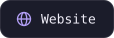</a>
  <a href="https://www.linkedin.com/in/neil-ermak/"></a>
  <a href="https://t.me/Ufb3heud"></a>
  <a href="https://t.me/drob_em_all">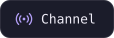</a>
</p>

I test web applications, APIs and infrastructure for security flaws, and I build backend services
and security tools, mostly in Rust. The two feed each other: knowing how things break shapes how I
build them. Most of my recent work is tooling for AI agents: a coding agent, and MCP servers that
give agents a memory and a contained Kali box.

<p align="center">
  
</p>

## Stack

```rust
let neil = Engineer {
    languages: ["Rust", "Python", "Bash"],
    security: ["Burp Suite", "Metasploit", "Wireshark", "Kali Linux"],
    data: ["PostgreSQL", "MongoDB", "ClickHouse", "SQLite", "Redis"],
    backend: ["FastAPI", "Nginx"],
    infra: ["Docker", "Linux", "Proxmox", "GitHub Actions"],
};
```

## Projects

<p align="center">
  <a href="https://github.com/DroBov1Tya/dusk_code"></a>
  <a href="https://github.com/DroBov1Tya/Aether"></a>
  <a href="https://github.com/DroBov1Tya/kali-mcp"></a>
  <a href="https://github.com/DroBov1Tya/PentaCore"></a>
  <a href="https://github.com/DroBov1Tya/Rusty-Hook"></a>
  <a href="https://github.com/DroBov1Tya/xbot"></a>
  <a href="https://github.com/DroBov1Tya/DBMorph"></a>
  <a href="https://github.com/DroBov1Tya?tab=repositories"></a>
</p>

## Activity

<p align="center">
  
  
</p>

## Contact

- **Work and collaboration:** [Telegram](https://t.me/Ufb3heud), [LinkedIn](https://www.linkedin.com/in/neil-ermak/) or [the site](https://drobov1tya.github.io/persona/).
- **Bug in one of my tools:** open an issue in its repository.
- **Security issue:** report it privately via *Security → Report a vulnerability* in the affected repository, not in a public issue.

<p align="center">
  <a href="https://drobov1tya.github.io/persona/"></a>
</p>
